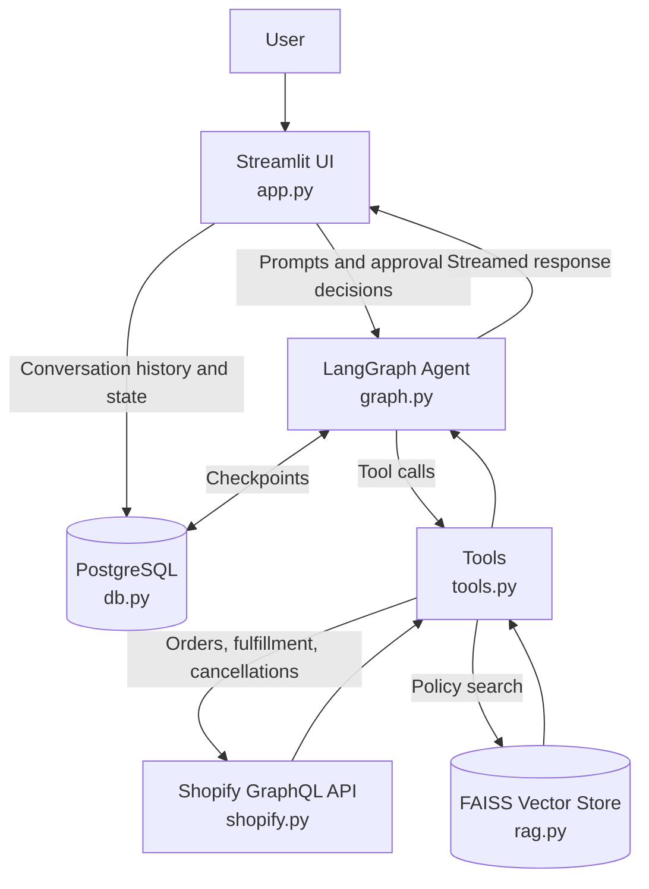

# 🛍️ ShopAssist: AI Customer Support Agent

[](https://streamlit.io/)
[](https://www.langchain.com/langgraph)
[](https://ai.google.dev/)
[](https://www.postgresql.org/)
[](https://github.com/facebookresearch/faiss)

ShopAssist is an AI customer support agent for Shopify stores, built with Streamlit and LangGraph. It combines agentic retrieval-augmented generation (RAG) over store policies with live Shopify order and fulfillment lookups. High-impact actions such as order cancellations pause for human approval.

## ✨ Key Features

- **Agentic RAG:** The LangGraph agent selects tools as needed, searching policy documents in a FAISS vector store or retrieving current order and fulfillment data through Shopify's GraphQL API.
- **Human-in-the-Loop (HITL):** Order cancellation pauses with a LangGraph interrupt and presents order details for approval before the Shopify mutation runs.
- **Real-time streaming:** LangGraph v2 `graph.stream` events stream model tokens and display tool progress. The app uses the synchronous stream API with `PostgresSaver`; it does not use `astream_events`.
- **Session isolation:** A browser cookie namespaces conversation thread IDs so the sidebar only lists conversations for that browser session. This is session isolation, not authentication.
- **PII redaction:** Email addresses, common phone numbers, and credit card number patterns in prompts are redacted before they are sent to the graph.
- **PostgreSQL checkpointing:** A cached, health-checked psycopg connection pool backs the PostgreSQL checkpointer, helping it recover from idle database connections and supporting conversation resumption.

## 🏗️ Architecture



## 🚀 Quickstart

### Prerequisites

- Python 3.11 or newer
- [`uv`](https://docs.astral.sh/uv/)
- A PostgreSQL database (for example, Neon)
- Shopify Admin API credentials with the permissions needed to read orders and perform cancellations
- A Google Gemini API key

### Local development

1. **Clone the repository and enter its directory:**

   ```powershell
   git clone https://github.com/hamzahassan123/shop-assist.git
   cd shop-assist
   ```

2. **Install dependencies:**

   ```powershell
   uv sync
   ```

3. **Create and configure the environment file:**

   ```powershell
   Copy-Item .env.example .env
   ```

   Set `DATABASE_URL`, `GOOGLE_API_KEY`, `SHOPIFY_SHOP`, `SHOPIFY_CLIENT_ID`, and `SHOPIFY_CLIENT_SECRET` in `.env`. The Shopify store value should be the shop name used by the Admin API URL, without `.myshopify.com`. Storefront URL and password settings are optional. Keep `.env` private and never commit credentials.

4. **Initialize the PostgreSQL checkpointer tables:**

   ```powershell
   uv run python -m shop_assist.setup_db
   ```

5. **Build the policy vector store** (after adding policy `.md` files under `data/policies/`; run again when policies change):

   ```powershell
   uv run python -m shop_assist.build_rag
   ```

6. **Start the Streamlit app:**

   ```powershell
   uv run python -m streamlit run src/shop_assist/app.py
   ```

   If the `uv run streamlit` launcher fails on Windows, invoking Streamlit with `python -m` as above avoids that launcher issue.

## 🧪 Testing

Run the test suite with:

```powershell
uv run pytest tests/
```

## 📸 Demo

<p align="center">
  
</p>

<!--
## Hidden developer notes

feat: modernize ShopAssist customer support architecture

- Stream LangGraph responses and expose tool progress in the Streamlit chat
- Add human approval interrupts for Shopify order cancellations
- Redact common PII from prompts before graph execution
- Isolate conversations with cookie-based thread namespacing
- Cache the PostgreSQL checkpointer and compiled graph

DALL-E hero image prompt:
"Create a polished, welcoming hero illustration for an open-source Shopify customer support assistant named ShopAssist. Show a friendly abstract AI helper beside a shopping bag, with subtle chat bubbles, package tracking motifs, and a small knowledge-library visual. Clean modern vector art, warm teal and coral accents on a light neutral background, generous negative space, wide horizontal composition, no text, no logos, no watermark."
-->
